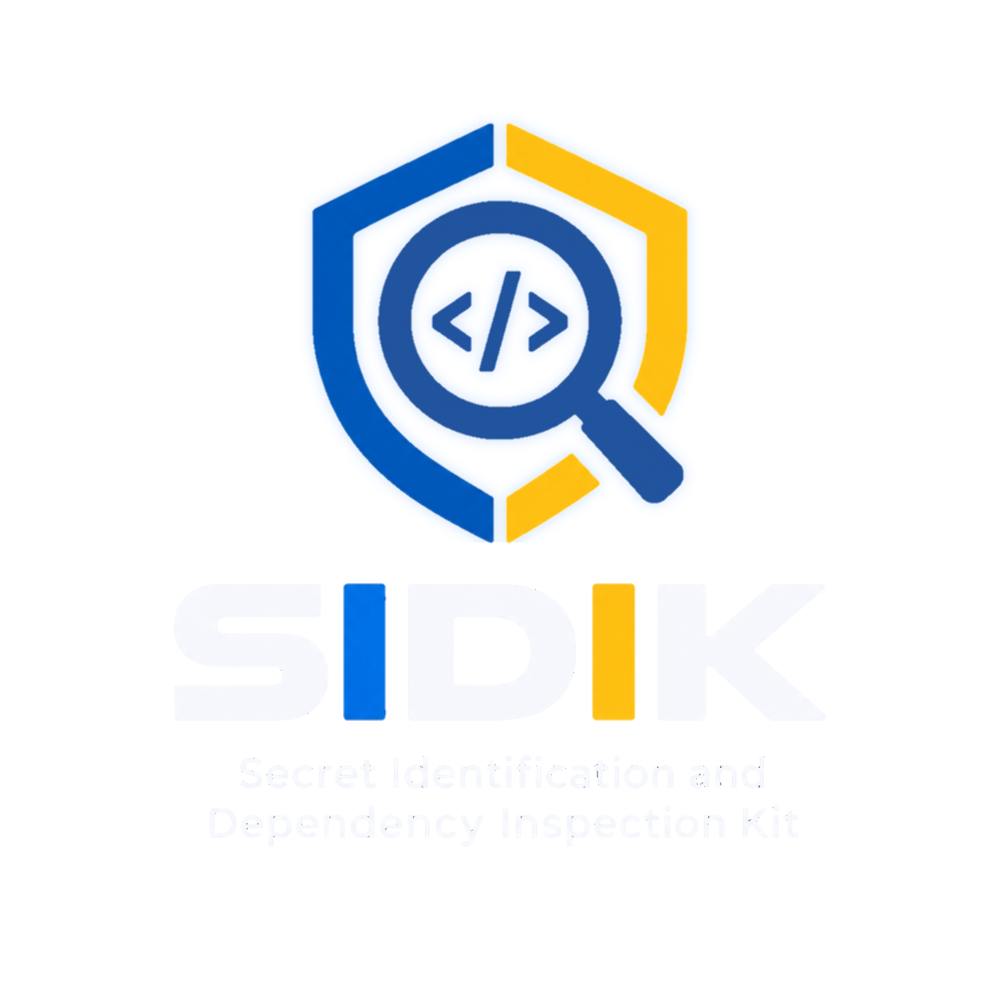

<div align="center">



# SIDIK: *Secret Identification and Dependency Inspection Kit*

**Instrumen Analisis Keamanan Statis (*SAST*) & Analisis Komposisi Perangkat Lunak (*SCA*) Luring Terpadu untuk Ekosistem Python**  
*Unified Offline Static Application Security Testing (SAST) & Software Composition Analysis (SCA) for Python*

[](#)
[](#)
[](#)
[](#)

</div>

---

# 🇮🇩 Bahasa Indonesia

## 📌 Ikhtisar Proyek

**SIDIK** (*Secret Identification and Dependency Inspection Kit*) adalah instrumen analisis keamanan statis (*Static Application Security Testing* / SAST) dan analisis komposisi perangkat lunak (*Software Composition Analysis* / SCA) terpadu berbasis Python yang beroperasi **100% secara luring (*offline*)** tanpa mengirim kode sumber ke peladen pihak ketiga (*zero data leakage*).

Dengan mengintegrasikan **12 aturan ekspresi reguler (*regex*) terkurasi**, **kalkulasi entropi informasi Shannon**, dan **penyaringan konteks leksikal** bersama **basis data kerentanan lokal Google OSV (`29.208` rekaman advisori lintas `8.038` paket PyPI)** yang mendukung **5 format manifes Python**, SIDIK dirancang untuk mengatasi masalah kejenuhan peringatan (*alert fatigue*) sekaligus menghilangkan ketergantungan jaringan internet pada *pipeline* CI/CD maupun jaringan terisolasi (*air-gapped*).

### 👥 Tim Peneliti & Pengembang (Kontribusi Setara / *Equal First Authors*)
Jurusan Informatika, Fakultas Teknik, Universitas Sultan Ageng Tirtayasa (Untirta):
1. **Radityo Budi Waskito** (*Corresponding Author* - Orkestrasi *Pipeline* Terpadu, CLI Interaktif, & *GitHub Actions* CI/CD)
2. **Fauzi Nur Ibrahim** (Mesin Deteksi *Hardcoded Secret* 3 Lapis, Entropi Shannon, & Konteks Leksikal)
3. **Raditya Ahmad Pratama** (Mesin *Offline SCA* 5 Format Manifes, Evaluator Versi Semantik PEP 440, & Indeks OSV)
4. **Zayyan Fadhlur Rahman** (Konstruksi Korpus 25 Repositori GitHub Nyata, *Benchmark* SCA v2, & Evaluasi Komparatif)
5. **Muhammad Fahri Indra Saputra** (*Desktop GUI High-DPI* Dwibahasa, Lokalisasi `i18n`, & Pelaporan 7 Format termasuk SARIF v2.1.0)

---

## ✨ Fitur dan Kapabilitas Utama

1. **Deteksi *Hardcoded Secret* 3 Lapis (*Multi-Layer Secret Detection*):**
   - Mendeteksi 12 kategori kredensial sensitif (`SEC001` - `SEC012`: *AWS Access Key ID*, *Google API Key*, *OpenAI API Key*, *Stripe Live Key*, *GitHub Classic & Fine-Grained PAT*, *Slack Token*, *JSON Web Token*, *Hardcoded Password*, *Database Connection URI*, *Asymmetric Private Key*, dan *Generic High-Entropy Secret*).
   - Dilengkapi penyaring baris cepat (*fast line pre-check*), kalkulasi entropi Shannon, dan penyaringan konteks leksikal untuk mengeliminasi alarm palsu dari variabel tiruan (*mock*, *dummy*, *example*, *sample*, *test fixture*), UUID, maupun *hash* Git SHA-1.
2. **Analisis Komposisi Perangkat Lunak Luring (*Offline Multi-Manifest SCA*):**
   - Mendukung **5 format manifes dependensi Python**: `requirements.txt`, `pyproject.toml` (PEP 621 & Poetry), `Pipfile`, `poetry.lock`, dan `setup.py` (ekstraksi AST aman tanpa eksekusi kode dinamis).
   - Mengevaluasi spesifikasi versi terkunci (`==`) maupun rentang versi fleksibel (`>=`, `~=`, `<`, `!=`) sesuai standar PEP 440 terhadap **`29.208` rekaman advisori kerentanan PyPI** secara instan tanpa koneksi internet.
3. **Tiga Mode Antarmuka (*Triple-Interface Ecosystem*):**
   - **Mode 1 - *One-Shot CLI* & Otomasi CI/CD (`python -m sidik` / `action.yml`):** Mendukung *git pre-commit hook* otomatis (`--install-hook`), ambang batas kegagalan (`--fail-on {any,low,medium,high,critical}`), dan integrasi *GitHub Actions*.
   - **Mode 2 - *Interactive CLI Menu* (`run_sidik_cli.bat` / `python sidik.py --cli`):** Antarmuka terminal interaktif berbasis menu bernomor yang mudah dioperasikan tanpa menghafal argumen baris perintah.
   - **Mode 3 - *Desktop GUI High-DPI* Dwibahasa (`run_sidik.bat` / `python sidik.py --gui`):** Antarmuka visual modern bertema gelap (*dark mode*) dengan 5 tombol *preset* korpus riset, pencarian instan (*live search*), penyalinan massal kode & solusi (*bulk copy*), serta tab **Visualisasi & Hasil Riset** yang merender grafik *benchmark* secara adaptif (*auto-resize*).
4. **Dukungan Dwibahasa Dinamis (*Instant Bilingual Toggle* ID ↔ EN) & Panduan Remediasi:**
   - Seluruh tampilan GUI, laporan konsol, dan rekomendasi perbaikan spesifik per aturan/CVE dapat dialihkan secara instan antara **Bahasa Indonesia (`id`)** dan **Bahasa Inggris (`en`)**.
5. **Tujuh Format Ekspor Laporan Standar Industri:**
   - Mendukung ekspor ke **Konsol Berwarna ANSI** (`console`), **OASIS SARIF v2.1.0** (`sarif` untuk *GitHub Code Scanning*), **GitHub Actions Workflow Annotations** (`github`), **Dasbor Web HTML Mandiri** (`html`), **Markdown** (`markdown`), **JSON Terstruktur** (`json`), dan **Tabel CSV/Spreadsheet** (`csv`).
6. **Mekanisme Pengecualian Fleksibel (*Whitelist & Ignore Support*):**
   - Mendukung berkas `.sidikignore` (sintaks pola `.gitignore`) serta komentar penekan sebaris (`# sidik:ignore`, `# nosec`, `# noqa: sidik`).

---

## 📁 Struktur Direktori Repositori

```text
SIDIK/
├── logo/                              # Aset identitas visual & ikon aplikasi multi-resolusi
├── sidik/                             # Paket inti mesin pemindai SIDIK
│   ├── __init__.py                    # Metadata paket & ekspor publik
│   ├── __main__.py                    # Titik masuk modul (python -m sidik)
│   ├── cli.py                         # Antarmuka One-Shot CLI, TUI Interaktif, & Git Hook
│   ├── core.py                        # Orkestrator SecurityScanner (SAST + SCA terpadu)
│   ├── gui.py                         # Antarmuka Desktop GUI High-DPI & Visualisasi Riset
│   ├── i18n.py                        # Mesin lokalisasi dwibahasa (ID/EN) & kamus remediasi
│   ├── models.py                      # Struktur data (Finding, ScanSummary, ScanReport)
│   ├── data/
│   │   └── pypi_advisories.json       # Basis data luring 29.208 advisori OSV (8.038 paket PyPI)
│   ├── secret_detector/               # Subsistem deteksi kredensial rahasia 3 lapis
│   │   ├── patterns.py                # 12 aturan ekspresi reguler terkurasi (SEC001-SEC012)
│   │   ├── entropy.py                 # Kalkulator entropi informasi Shannon
│   │   ├── context.py                 # Penyaring konteks leksikal & indikator mock/test
│   │   └── detector.py                # Mesin pemindai secret dengan fast line pre-check
│   ├── dependency_analyzer/           # Subsistem analisis dependensi luring (Offline SCA)
│   │   ├── parsers.py                 # Pengurai 5 format manifes (req, toml, Pipfile, lock, setup.py)
│   │   ├── matcher.py                 # Pencocok rentang versi semantik PEP 440
│   │   ├── database.py                # Pengelola indeks advisori kerentanan lokal
│   │   ├── osv_import.py              # Kompilator snapshot Google OSV PyPI ke indeks lokal
│   │   └── analyzer.py                # Orkestrator pemindaian manifes dependensi
│   └── reporting/                     # Subsistem agregasi, deduplikasi, & 7 format laporan
│       ├── aggregator.py              # Penggabung temuan & kalkulator ringkasan keparahan
│       └── formatter.py               # Generator laporan (Console, SARIF, GitHub, HTML, MD, JSON, CSV)
├── dataset/                           # Korpus pengujian empiris (Zero Data Leakage)
│   ├── external/                      # Korpus 25 repositori GitHub nyata (186.876 LOC, 109 kandidat)
│   ├── dependencies_v2/               # Benchmark SCA v2 (70 manifes rakitan rilis PyPI; 39 berkas uji / N=200)
│   ├── secrets/                       # Dataset uji terkontrol & studi ablasi secret (N=100 berkas uji)
│   ├── dependencies/                  # Dataset manifes dependensi v1 (N=60)
│   └── ground_truth/                  # Anotasi label kebenaran dasar (JSON)
├── experiments/                       # Skrip otomatis evaluasi ilmiah & komparasi alat industri
│   ├── run_external_benchmarks.py     # Benchmark 25 repo nyata & komparasi Gitleaks, Bandit, Trivy, pip-audit
│   ├── run_experiments.py             # Evaluasi dataset terkontrol terhadap baseline internal
│   ├── ablation_study.py              # Studi ablasi 4 konfigurasi komponen (Konfig A, B, C, D)
│   ├── evaluate_metrics.py            # Kalkulator metrik (Precision, Recall, F1, MCC, FPR, FNR)
│   └── generate_charts.py             # Generator grafik publikasi (300 DPI) & bundel visualisasi GUI
├── figures/                           # Grafik hasil eksperimen (Paper & Dark-Theme GUI Bundle)
├── results/                           # Rekaman JSON hasil eksperimen & benchmark komparatif
├── tests/                             # Suite pengujian otomatis (51 unit & integration tests)
├── action.yml                         # Definisi komposit GitHub Actions untuk integrasi CI/CD
├── sidik.py                           # Peluncur universal (GUI, Interactive CLI, & One-Shot CLI)
├── run_sidik.bat                      # Peluncur cepat Desktop GUI (Windows)
├── run_sidik_cli.bat                  # Peluncur cepat Interactive CLI Menu (Windows)
├── run_sidik.sh                       # Peluncur lintas platform (Linux / macOS)
└── requirements.txt                   # Daftar dependensi runtime & visualisasi
```

---

## 📊 Hasil Evaluasi Empiris & *Benchmark* Komparatif

Seluruh hasil pengujian direkam secara transparan di direktori [`results/`](file:///d:/Downloads/SIDIK-root/SIDIK/results) dan divisualisasikan di [`figures/`](file:///d:/Downloads/SIDIK-root/SIDIK/figures):

### 1. Evaluasi Deteksi *Hardcoded Secret* pada 25 Repositori GitHub Nyata (`186.876` LOC, `1.193` Berkas `.py`, `109` Kandidat)
> **Catatan Transparansi Korpus:** Ke-25 repositori publik memiliki `0` kebocoran kunci produksi aktif (`TP = 0`; seluruh `109` kandidat adalah kode pengujian/*fixture*/contoh dokumentasi). Oleh karena itu, evaluasi pada korpus ini mengukur ketahanan terhadap alarm palsu (*False Positive Rate* / FPR) dan kecepatan eksekusi.

| Perangkat Pemindai | Versi | *False Positive* (FP) | *True Negative* (TN) | *False Positive Rate* (FPR) | Waktu Pindai *Secret* | Kecepatan (*Throughput*) |
| :--- | :---: | :---: | :---: | :---: | :---: | :---: |
| **Bandit** | `v1.9.4` | 98 | 11 | 89,91% | 25,26 dtk | 7.398 LOC/dtk |
| *Baseline Regex* | Internal | 14 | 95 | 12,84% | 3,34 dtk | 55.950 LOC/dtk |
| **SIDIK (Usulan)** | **Terpadu** | **14** | **95** | **12,84% (-85,7% vs Bandit)** | **3,19 dtk** | **58.581 LOC/dtk** |
| **Gitleaks** | `v8.30.1` | **0** | **109** | **0,00%** | 10,41 dtk | 17.951 LOC/dtk |

* Pada **Pemindaian Terpadu (*Unified Pipeline*: *Secret* + SCA + `tracemalloc`)** lintas 25 repositori nyata, SIDIK menuntaskan pemeriksaan dalam **`4,64 detik`** (`~2,55 detik` jika dipindai sekaligus) dan mengidentifikasi **`302` kerentanan dependensi nyata** pada 45 berkas manifes proyek publik.

### 2. Evaluasi *Software Composition Analysis* (SCA v2) pada Rilis Paket PyPI (`N=200` Entri di `39` Manifes Uji)

| Perangkat SCA | Cakupan Format Manifes | TP | FP | TN | FN | *Precision* | *Recall* | *F1-Score* | Waktu Pindai |
| :--- | :--- | :-: | :-: | :-: | :-: | :---: | :---: | :---: | :---: |
| **`pip-audit`** (`v2.10.1`) | `requirements.txt` saja (`N=37`) | 0 | 0 | 20 | 17 | 0,0000 | 0,0000 | 0,0000 | 0,15 dtk |
| **Trivy** (`v0.76.1`) | Wajib *lockfile* (`N=200`) | 35 | 0 | 100 | 65 | 1,0000 | 0,3500 | 0,5185 | 132,00 dtk |
| **SIDIK (Usulan)** | **5 Format Lengkap (`N=200`)** | **100** | **0** | **100** | **0** | **1,0000** | **1,0000** | **1,0000** | **0,33 dtk** |

### 3. Studi Ablasi Komponen pada Dataset Uji Terkontrol *Secret* (`N=100` Berkas: `50` Positif, `50` Negatif)

| Konfigurasi Ablasi | *True Positive* (TP) | *False Positive* (FP) | *True Negative* (TN) | *False Negative* (FN) | *Precision* | *Recall* | *F1-Score* | MCC |
| :--- | :---: | :---: | :---: | :---: | :---: | :---: | :---: | :---: |
| **Konfig A (*Regex* Saja)** | 45 | 10 | 40 | 5 | 0,8182 | 0,9000 | 0,8572 | 0,7035 |
| **Konfig B (*Regex* + Konteks)** | 45 | **0** | **50** | 5 | **1,0000** | 0,9000 | **0,9474** | **0,9045** |
| **Konfig C (*Regex* + Entropi)** | 45 | 10 | 40 | 5 | 0,8182 | 0,9000 | 0,8572 | 0,7035 |
| **Konfig D (SIDIK Penuh)** | 45 | **0** | **50** | 5 | **1,0000** | 0,9000 | **0,9474** | **0,9045** |

### 4. Profil Transparan Konsumsi Memori (RAM) & Waktu Eksekusi
* **Alokasi Memori Pemindaian Aktif (*Active Scanning Memory*):** Berkisar **`0,15 MB - 0,91 MB` per repositori** (rerata **`0,39 MB`** per repositori pada 25 proyek GitHub; **`0,13 - 0,21 MB`** pada uji *secret* `N=100`; serta **`1,58 MB`** untuk pemindaian gabungan 25 repositori sekaligus).
* **Inisialisasi Basis Data OSV Luring (*One-Time DB Index Load*):** Membutuhkan **`116,47 MB`** satu kali di awal (*singleton cache*) saat memuat indeks `29.208` rekaman advisori JSON ke memori.

---

## 🚀 Panduan Penggunaan Cepat (*Quick Start*)

### 1. Instalasi Dependensi
Pastikan Python `3.10+` telah terpasang, lalu pasang dependensi:
```bash
pip install -r requirements.txt
```

### 2. Menjalankan *Desktop GUI* (Mode Visual)
```bash
python sidik.py --gui
# atau klik dua kali run_sidik.bat pada Windows
```
* Gunakan tombol **`🌐 English (EN)` / `🌐 Indonesia (ID)`** di kanan atas untuk mengganti bahasa secara instan.
* Gunakan 5 tombol **Presets** (`Uji Secrets (N=100)`, `Uji Dependensi v2`, `25 Repo Eksternal (Secret)`, `25 Repo Eksternal (Full)`, `Kode Sumber SIDIK`) untuk mendemonstrasikan hasil riset secara langsung.
* Buka tab **`Visualisasi & Hasil Riset`** untuk melihat grafik evaluasi RQ1 - RQ4 dan *Master Bundle*.

### 3. Menjalankan *Interactive CLI Menu* (Mode Terminal Interaktif)
```bash
python sidik.py --cli
# atau klik dua kali run_sidik_cli.bat pada Windows
```

### 4. Menjalankan *One-Shot CLI* & Ekspor 7 Format Laporan
```bash
# Pemindaian standar di terminal (Bahasa Indonesia / Inggris)
python -m sidik --target dataset/secrets/test --lang id
python -m sidik --target dataset/dependencies_v2/test --lang en

# Ekspor ke 7 format laporan (console, json, markdown, csv, html, sarif, github)
python -m sidik --target dataset/external/_repos --format html --output results/audit_report.html
python -m sidik --target dataset/external/_repos --format sarif --output results/sidik.sarif

# Pasang Git Pre-Commit Hook otomatis & ambang batas CI/CD
python -m sidik --install-hook
python -m sidik --target . --fail-on high
```

### 5. Menjalankan 51 *Unit Test* & Eksperimen *Benchmark*
```bash
# Jalankan seluruh 51 unit & integration tests
python -m unittest discover tests -v

# Jalankan eksperimen & buat ulang seluruh grafik riset
python experiments/run_experiments.py
python experiments/ablation_study.py
python experiments/run_external_benchmarks.py
python experiments/generate_charts.py
```

---

# 🇬🇧 English

## 📌 Project Overview

**SIDIK** (*Secret Identification and Dependency Inspection Kit*) is a unified, lightweight Static Application Security Testing (SAST) and Software Composition Analysis (SCA) instrument for Python projects that operates **100% offline** with **zero data leakage**.

By combining **12 curated regular expression rules**, **Shannon entropy verification**, and **lexical context filtering** with an **offline Google OSV advisory database (`29,208` vulnerability records across `8,038` PyPI packages)** supporting **5 Python manifest formats**, SIDIK suppresses false alarms while eliminating network latency and internet dependencies in CI/CD pipelines and air-gapped environments.

---

## ✨ Key Features

1. **Three-Layer Secret Detection Engine:**
   - Covers 12 credential categories (`SEC001` - `SEC012`: AWS, Google Cloud, OpenAI, Stripe, GitHub Classic/Fine-Grained PAT, Slack, JWT, Password Assignments, Database URIs, Private Keys, and Generic Secrets).
   - Combines a fast line pre-check filter, Shannon entropy calculation, and lexical context analysis to suppress false positives from test fixtures, mock tokens, UUIDs, and Git SHA-1 hashes.
2. **Offline Multi-Manifest SCA Engine:**
   - Parses `requirements.txt`, `pyproject.toml` (PEP 621 & Poetry), `Pipfile`, `poetry.lock`, and `setup.py` (static AST parsing without code execution).
   - Evaluates exact pins (`==`) and semantic version ranges (`>=`, `~=`, `<`) against **`29,208` offline PyPI advisories** in `0.33s`.
3. **Triple-Interface Ecosystem & 7 Report Formats:**
   - Operates via **One-Shot CLI** (`python -m sidik`, `--install-hook`, `--fail-on`, GitHub Action `action.yml`), **Interactive CLI Menu** (`python sidik.py --cli`), and **High-DPI Bilingual Desktop GUI** (`python sidik.py --gui`).
   - Exports findings to **ANSI Console**, **OASIS SARIF v2.1.0**, **GitHub Actions Annotations**, **Standalone HTML Dashboard**, **Markdown**, **JSON**, and **CSV**.

---

## 📊 Summary of Empirical Benchmarks

| Benchmark Suite | Dataset Scale | SIDIK Result | Industry / Baseline Comparison |
| :--- | :--- | :--- | :--- |
| **1. Real-World GitHub Secret Scan** | 25 Repos (`186,876` LOC, `1,193` files, `109` candidates) | **14 FP (12.84% FPR)** in **3.19s** (`58,581` LOC/s; `4.64s` unified scan with **302** real dependency CVEs) | **85.7% fewer FPs** than Bandit (`98 FP / 89.91%`, `25.26s`); **3.3x faster** than Gitleaks (`0 FP`, `10.41s`) |
| **2. Multi-Manifest PyPI SCA v2** | `N=200` balanced entries across `39` test manifests (5 formats) | **100/100 TP (Precision 1.00, Recall 1.00, F1 1.00)** in **0.33s** | Outperforms Trivy (`35/100 TP`, `F1 0.5185`, `132.00s`) and `pip-audit` (`0/17 TP` on `N=37` unpinned `requirements.txt`) |
| **3. Controlled Secret Ablation** | `N=100` Python files (`50` positive, `50` negative traps) | **0 FP, 45 TP (Precision 1.00, Recall 0.90, F1 0.9474, MCC 0.9045)** | Context filter eliminates all **10 FPs** produced by regex-only baseline (`F1 0.8572`) |
| **4. Memory & Resource Profile** | `tracemalloc` across all benchmarks | **0.15 - 0.91 MB** active scan RAM/repo (avg **0.39 MB**; **1.58 MB** combined 25 repos) | Transparently reports **116.47 MB** one-time initialization for loading the `29,208`-record OSV JSON index |
